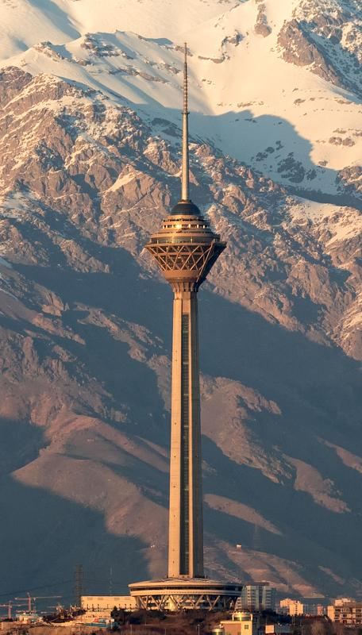

# My Favourite Place — Milad Tower

> "Milad Tower stands as an iconic symbol of modern Tehran, bridging sky and city."

Milad Tower is a multi-purpose telecommunications and observation tower in Tehran, Iran, notable for its height and vantage points over the city.

---

## Highlights
- Multi-purpose tower in Tehran, Iran
- Sixth-tallest tower in the world
- World's first telecommunication tower by top-structure usage area
- Tallest tower in Iran
- 24th-tallest freestanding structure in the world

---

## Quick specifications

| Feature | Detail |
|--------:|:------|
| Height  | 435 m |
| Floors (top structure) | 12 |
| Location | Tehran, Iran |
| Status  | Operational |

---

## Top attractions inside the tower

1. **Observation Deck** — Offers 360° panoramic views of Tehran.
2. **Revolving Restaurant** — Dining with rotating city views; one of the larger revolving restaurants in the world.
3. **Sky Lounge** — Lounge area at the top floor of the main dome.

---

## Technical data

```json
{
  "tower_name": "Milad Tower",
  "latitude": 35.7447,
  "longitude": 51.3753,
  "status": "Operational"
}
```

[More information about Milad Tower](https://en.wikipedia.org/wiki/Milad_Tower "Milad Tower — Wikipedia")



*Figure: Milad Tower, Tehran (photo: 2026).*
